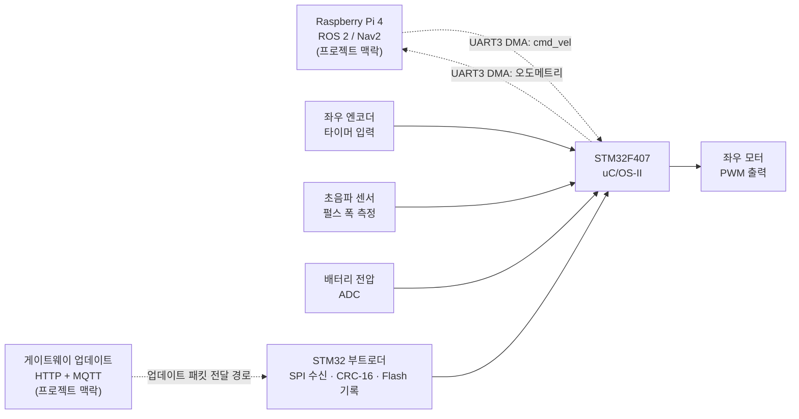

# LUMI — 시각장애인 실내 안전 안내 로봇

LUMI는 실내에서 시각장애인의 안전한 이동을 돕기 위해 기획된 안내 로봇 프로젝트입니다. 이 저장소에는 프로젝트의 **STM32F407 펌웨어, uC/OS-II 포팅 코드, 주변장치 드라이버와 OTA 부트로더**가 포함되어 있습니다.

> **저장소 범위 안내**
> 이 저장소는 Robot 펌웨어 저장소입니다. Raspberry Pi 4, ROS 2/Nav2, MQTT 게이트웨이, 음성 안내나 시각 인식 등 상위 로봇 기능의 구현 코드는 이 저장소에서 포함되지 않습니다.

## 목차

- [프로젝트 개요](#프로젝트-개요)
- [저장소에서 확인한 기능](#저장소에서-확인한-기능)
- [시스템 구조](#시스템-구조)
- [하드웨어 및 소프트웨어 스택](#하드웨어-및-소프트웨어-스택)
- [주요 구현](#주요-구현)
- [저장소 구조](#저장소-구조)
- [빌드](#빌드)
- [문제 해결 참고](#문제-해결-참고)
- [라이선스](#라이선스)

## 프로젝트 개요

LUMI는 시각장애인의 실내 이동을 보조하는 자율주행 안내 로봇 프로젝트입니다. 아래의 상위 시스템 설명은 프로젝트 맥락으로 제공된 정보이며, 이 저장소에서 직접 검증되는 펌웨어 구현과 구분해 적었습니다.

| 구분 | 설명 | 근거 |
|---|---|---|
| 목적 | 실내 안전 안내 및 이동 보조 | 저장소 설명 및 프로젝트 맥락 |
| 임베디드 제어 | STM32F407, uC/OS-II, 모터 제어·센서·통신·부트로더 | 저장소 코드와 빌드 설정 |
| 상위 자율주행 | Raspberry Pi 4에서 ROS 2/Nav2를 이용해 주행 명령 생성 | 프로젝트 맥락; 상위 시스템 소스는 이 저장소에 없음 |
| 관제·업데이트 | MQTT 조정 및 HTTP를 이용한 게이트웨이 펌웨어 다운로드 | 프로젝트 맥락; 게이트웨이 구현은 이 저장소에 없음 |

## 저장소에서 확인한 기능

- STM32F407용 Cortex-M4 펌웨어 및 링커 설정
- uC/OS-II 커널 소스와 Cortex-M4 포트
- 좌우 모터 PWM 출력 및 타이머 엔코더 입력
- 50 ms 주기의 휠 속도 계산과 PID + feedforward 제어
- Raspberry Pi와 UART3 DMA로 주행 명령을 주고받는 펌웨어 경로
- 휠 엔코더 기반 차동구동 오도메트리 계산 및 UART DMA 전송
- 초음파 에코 펄스 폭 측정과 거리 필터링
- ADC 기반 배터리 전압 확인과 저전압 표시
- SPI 슬레이브 모드에서 1024-byte 단위로 펌웨어를 수신하고 패킷 CRC-16을 검사하는 부트로더


## 시스템 구조

아래 도식은 임베디드 저장소에서 확인한 데이터 흐름을 중심으로 그렸습니다. 점선은 저장소 코드가 아니라 프로젝트 맥락으로 제공된 상위 시스템 연결입니다.




## 하드웨어 및 소프트웨어 스택

### 저장소에서 확인한 구성

| 구분 | 구성 |
|---|---|
| MCU | STM32F407 계열, ARM Cortex-M4 |
| RTOS | uC/OS-II 커널 및 Cortex-M 포트 |
| 컴파일러 | GNU Arm Embedded Toolchain (`arm-none-eabi-gcc`, `arm-none-eabi-objcopy`) |
| 빌드 | GNU Make |
| 모터 출력 | TIM1/TIM8 PWM |
| 엔코더 입력 | TIM3/TIM5 Encoder Mode |
| 통신 | SPI1 부트로더 수신, USART3 UART 및 DMA |
| 센서/주변장치 | 초음파 센서용 TIM4 입력 캡처, ADC1 배터리 입력, GPIO LED·버튼 |
| 링커 메모리 배치 | 부트로더 `0x08000000`, 애플리케이션 `0x08010000`부터 |

STM32F407 구체 모델 및 클록·보드 연결 정보는 실제 사용 보드와 일치하는지 프로젝트 보유자가 확인해 주세요. 펌웨어에 주변장치 레지스터 및 일부 핀 설정은 있지만, 별도 회로도나 전체 핀맵은 저장소에 없습니다.

### 프로젝트 맥락으로 제공된 상위 구성

- Raspberry Pi 4에서 ROS 2/Nav2를 구동하고 `/cmd_vel` 기반 주행 명령을 STM32로 전달
- IMU, 휠 오도메트리, 초음파 센서 정보를 로봇 주행에 사용
- Raspberry Pi 게이트웨이가 HTTP로 업데이트 파일을 받고 MQTT/Mosquitto로 업데이트 흐름을 조정

이는 프로젝트 설명에서 제공된 정보이며, 상위 스택의 패키지·버전·설정과 실제 연동 코드는 이 저장소에 포함되지 않습니다.

## 주요 구현

### uC/OS-II 태스크와 동기화

애플리케이션은 시작 태스크에서 보드 주변장치를 초기화하고 다음 작업 태스크들을 생성합니다.

| 태스크 | 코드상 역할 |
|---|---|
| `ComputeTargetRpmTask` | 수신한 선속도·각속도로 좌우 목표 RPM 계산 |
| `MotorSpeedControlTask` | 엔코더 변화량으로 RPM을 구하고 PID 제어, 오도메트리 태스크에 데이터 전달 |
| `UpdateWheelOdometry` | 휠 이동량과 로봇 위치·속도를 계산하고 UART로 전송 |
| `UltrasonicSensorTask` | 초음파 트리거, 에코 대기, 거리 필터링 및 임계 거리 표시 |
| `OTATrigTask` | 버튼 신호 후 입력 상태를 확인하여 소프트웨어 리셋 수행 |
| `BatteryCheckTask` | ADC 전압을 읽고 임계값 미만이면 표시 출력 |
| `AppTaskComm` | 현재는 주기 지연 중심의 통신/디버그 태스크 |

위 일곱 개의 애플리케이션 태스크 외에 초기화 후 삭제되는 시작 태스크가 있습니다. 따라서 “6개 태스크”라는 외부 요약과 달리 현재 저장소 코드에는 일곱 개의 작업 태스크 생성 호출이 보입니다. 태스크 수를 프로젝트 소개에 사용할 때 기준을 맞춰 주세요.

코드는 태스크 간 이벤트 전달에 세마포어와 메일박스를 사용하고, UART mutex 객체도 생성합니다. 예를 들어 DMA 수신 완료 인터럽트는 세마포어를 게시하고, 모터 제어 태스크는 엔코더 차분 구조체를 메일박스에 게시해 오도메트리 태스크를 깨웁니다.

### `/cmd_vel`에서 좌우 모터까지

펌웨어는 Raspberry Pi에서 UART3 DMA로 고정 길이 8-byte 버퍼를 수신합니다. 코드에서는 버퍼의 앞 4 byte와 뒤 4 byte를 각각 `float` 선속도와 각속도로 읽습니다. 현재 저장소 코드에선 DMA 전송 완료 인터럽트가 수신 버퍼를 다시 준비하고 세마포어를 게시합니다.

차동구동 변환은 소스에 정의된 휠 반지름(0.075 m)과 휠 간격(0.400 m)을 사용합니다.

```text
v_left  = linear_x - angular_z × wheel_base / 2
v_right = linear_x + angular_z × wheel_base / 2
RPM     = wheel_linear_velocity × 60 / (2π × wheel_radius)
```

수신 패킷의 바이트 순서, 부동소수점 표현과 송신 측 직렬화 방식이 양쪽에서 일치해야 합니다. UART의 실제 baud rate 등 전체 직렬 연결 설정은 연결 환경에 맞춰 확인해야 합니다.

### 엔코더 기반 속도 제어

- TIM3/TIM5가 좌우 엔코더 카운트를 읽고, 50 ms 간격의 카운터 차이로 회전 속도를 추정합니다.
- 제어 출력은 `P + I + D + feedforward` 형태이며, 오차 크기에 따라 빠른 응답 구간과 정상 추종 구간의 게인을 바꿉니다.
- 적분항에는 ±30 범위 제한이 적용됩니다.
- Feedforward는 RPM/CCR 표를 선형 보간하고 PWM 비교값은 0~999로 제한합니다.
- 출력 PWM은 TIM1 채널 1 및 TIM8 채널 4에 기록됩니다.

RPM 환산 상수, 엔코더 분해능, 기어비 및 휠 치수는 실제 모터·엔코더 구성에 의존합니다. 하드웨어를 바꾸면 해당 상수와 제어기를 함께 재조정해야 합니다.

### 휠 오도메트리 전송

엔코더 변화량을 바퀴 이동 거리로 변환한 뒤 차동구동 모델로 `x`, `y`, `theta`를 누적합니다. 전송 구조체에는 `0xAA 0x55` 헤더, tick 기반 timestamp, 위치, 선속도, 각속도와 XOR 체크섬이 정의되어 있습니다. 프레임 레이아웃은 C 구조체의 packed 형식으로 구성됩니다.

이 구현은 휠 엔코더 기반 추정입니다. IMU 융합, 보정 또는 ROS 메시지 변환은 현재 저장소에서 확인되지 않습니다.

### 초음파 및 배터리 입력

초음파 에코는 TIM4 입력 캡처로 펄스 폭을 측정하고, 태스크에서 거리(cm)를 계산합니다. 소스에는 2~100 cm 범위 밖의 측정값을 직전 유효값으로 대체하고 5개 샘플 중앙값 필터를 적용하는 코드가 있습니다. 코드의 거리 임계값은 30 cm이며, 이에 따라 GPIO 출력을 제어합니다.

배터리는 PB0/ADC1 채널 8에서 읽고, 코드의 분압 계산은 ADC 기준전압 3.3 V와 배율 4를 사용합니다. 저전압 기준은 11.5 V로 정의되어 있으며 기준 아래에서 LED 출력이 켜집니다. 코드 주석에는 부저라고 적혀 있지만 실제 출력은 `led_on()`/`led_off()` 호출이므로 보드 연결에 맞춰 설명과 주변장치 이름을 확인해야 합니다.

### SPI 부트로더와 펌웨어 업데이트

부트로더는 소프트웨어 리셋 원인을 확인한 뒤 SPI1 수신 전용 슬레이브를 초기화하고, 1024-byte 프레임을 인터럽트로 수신합니다. 프레임 헤더에서 패킷 번호, 마지막 패킷 여부, 유효 데이터 길이를 읽고, 패킷 순서와 CRC-16을 검사한 뒤 플래시에 4-byte 단위로 기록합니다. CRC 함수는 초기값 `0xFFFF`와 다항식 `0xA001`을 사용합니다. 앱 시작 주소는 `0x08010000`이며 링커 스크립트에서 부트로더와 앱 영역이 분리되어 있습니다.

프로젝트 맥락에서는 게이트웨이가 HTTP를 통해 업데이트 파일을 내려받고 MQTT/Mosquitto가 업데이트 흐름을 조정한다고 설명되어 있습니다. 다만 이 저장소는 그 게이트웨이 코드를 포함하지 않으며, 부트로더의 전체 이미지 검증 함수 `crc_check_image()`는 현재 성공/실패 검사를 수행하는 완성 구현이 아니라 로그 자리표시자로 남아 있습니다. 따라서 README에서 전체 이미지 CRC 검증이 완료되어 있다고 표현하지 않습니다.

## 저장소 구조

```text
.
├── Makefile
├── README.md
├── LICENSE
├── app/
│   ├── app.ld                  # 앱 메모리 시작 주소: 0x08010000
│   ├── inc/                    # 앱 및 uC/OS-II 설정 헤더
│   └── src/
│       ├── main.c              # RTOS 태스크, 모터 제어, 오도메트리, 센서
│       ├── interrupt_app.c     # 타이머, 버튼, SPI, DMA 인터럽트
│       ├── startup.c           # 벡터 테이블 및 초기화
│       ├── wheel.c             # 휠 방향 제어
│       └── uCOS-II/
│           ├── Ports/          # Cortex-M 포트
│           └── Source/         # uC/OS-II 커널 소스
├── bootloader/
│   ├── bootloader.ld           # 부트로더 메모리 시작 주소: 0x08000000
│   ├── inc/
│   └── src/
│       ├── main_bl.c           # SPI 업데이트, CRC-16, Flash 기록, 앱 점프
│       ├── interrupt_bl.c
│       └── startup_bl.c
└── common/
    ├── inc/                    # ADC, DMA, Flash, GPIO, SPI, Timer, UART 등 헤더
    └── src/                    # 공통 주변장치 드라이버
```

## 빌드

저장소의 Makefile에 정의된 빌드 도구는 GNU Make와 `arm-none-eabi-gcc`, `arm-none-eabi-objcopy`입니다. 컴파일 옵션은 Cortex-M4/Thumb 및 하드웨어 부동소수점(`fpv4-sp-d16`, hard-float)을 사용합니다.

Linux 또는 WSL 환경에서 해당 도구가 PATH에 설치되어 있으면 저장소 루트에서 다음 대상을 실행할 수 있습니다.

```bash
make
```

Makefile은 부트로더와 앱 이미지를 각각 만들고 `build/image.bin`으로 결합합니다. 다만 기본 `all` 대상은 끝에서 결과물을 `/mnt/c/wsl2 workspace/image.bin`에 복사하도록 하드코딩되어 있어 이 경로가 없는 환경에서는 복사 단계가 실패할 수 있습니다. 플래시 기록, 보드 업로드, Raspberry Pi 노드 실행 절차는 저장소에 제공되어 있지 않으므로 임의의 명령을 제시하지 않습니다.

정리 대상:

```bash
make clean
```


## 문제 해결 참고

| 증상 | 확인할 내용 |
|---|---|
| 빌드 도구를 찾지 못함 | `make`, `arm-none-eabi-gcc`, `arm-none-eabi-objcopy`가 설치되어 있고 PATH에서 호출되는지 확인 |
| 빌드 마지막 복사 단계 실패 | Makefile의 `/mnt/c/wsl2 workspace/image.bin` 경로가 현재 WSL 환경에 존재하는지 확인 |
| UART 명령이 동작하지 않음 | Pi와 STM32의 UART 연결, 전압 레벨, baud rate, 8-byte 프레임, 두 `float` 값의 직렬화 순서를 확인 |
| 모터 속도·방향이 맞지 않음 | 모터 채널 매핑, 엔코더 방향, 부호 처리, RPM 환산 상수, feedforward 표와 PID 게인을 확인 |
| 오도메트리 드리프트 | 엔코더 분해능, 바퀴 반지름, 휠 간격 상수 및 방향 부호를 실제 로봇 치수와 대조 |
| OTA 패킷 오류 | SPI 프레임 길이 1024 byte, 순번, 헤더 필드, 마지막 패킷 표시, CRC-16 계산 범위를 송신기와 대조 |
| 부트로더 후 앱이 시작되지 않음 | 앱 벡터 테이블 및 링커 주소(`0x08010000`), 플래시 기록 결과, 리셋 원인 처리 확인 |
| 초음파 값이 고정되거나 튐 | 트리거/에코 연결, 타이머 캡처 입력, 유효 거리 범위 및 중앙값 필터 입력 확인 |

이 표는 소스에서 유추할 수 있는 점검 항목입니다. 현재 코드에는 일부 오류가 무한 대기 상태로 처리되며, 전체 이미지 CRC 검증은 구현되어 있지 않으므로 실제 하드웨어에서 업데이트를 시도할 때는 해당 동작을 별도로 검증해야 합니다.

## 라이선스

저장소의 `LICENSE` 파일은 MIT License이며, 저작권 표기는 `Copyright (c) 2026 S.K.C.`입니다. 배포 시 저장소의 라이선스 전문을 함께 포함하세요. uC/OS-II 및 타사 코드가 별도 조건을 가질 수 있으므로 저장소 라이선스 파일만으로 모든 포함 코드의 라이선스를 단정하지 않습니다.

